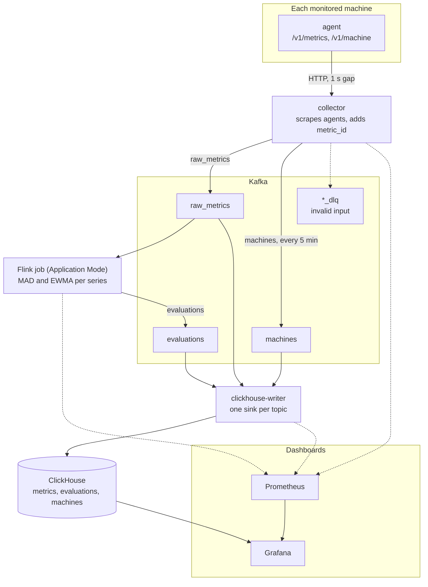

# Architecture diagram

Data flows top to bottom. Solid arrows carry data. Dotted arrows carry errors or scrapes.

## Notes

- The collector sends invalid input to `<topic>_dlq`.
- Prometheus scrapes the collector and clickhouse-writer on port 8000, and Flink on port 9249.
- Each sample keeps its `metric_id` from the collector to ClickHouse.
- The text description of these components is in [architecture](architecture.md).
